<!-- _class: journey cover -->
<!-- _paginate: skip -->

AWARENESS / PRACTICE / CHANGE

# Starting an **Allyship** Journey.

Not a label to earn. A practice to keep choosing.

Chris Ayers Principal Software Engineer / Microsoft

  

  
WITH. <em>Not for.</em>

  01 / NOTICE
  02 / LISTEN
  03 / ACT
  04 / LEARN

A JOURNEY, NOT A DESTINATION Next slide to continue / no clicking required

<!--
Invite people into a practice rather than asking them to claim an identity.
This expanded deck adapts the concepts, historical gaming data, and facilitation
notes from Chris Ayers's Allyship.pptx (2023). New workplace scenarios are fictional.
The source presentation remains unchanged. Advance slides to see every example
and response; no audience input is required or collected.
-->

---

BEFORE WE BEGIN / SHARED AGREEMENTS / 1 OF 2

## A conversation, not a performance.

<article class="enter"><b>01 / RESPECT</b><h3>Open-Minded Respect</h3>
Stay open to learning. Respect others. Treat shared experiences as confidential.
</article>
<article class="enter"><b>02 / LISTEN</b><h3>Active Listening and Understanding</h3>
Listen to understand, not to prepare a response. Seek understanding, not agreement.
</article>
<article class="enter"><b>03 / SPEAK</b><h3>Personal Expression</h3>
Use "I" statements. Ask for clarification. Allow each other to be unpolished.
</article>

Share your experience. Do not speak for a whole group.

<!--
These agreements come before introductions and content intentionally. Pause:
invite the room to agree how it will participate, rather than rushing past them.
Original notes: Approach discussions with openness to learn and respect for
others. Treat shared experiences and perspectives as confidential.
Listen attentively to understand, not to formulate your own response. Seek to
deepen understanding rather than to reach agreement.
Share your own experiences and insights using "I" statements. Ask for
clarification when needed and allow others to be unpolished in their speech.
Confidentiality is an agreement to request, not something a presenter can
guarantee. Agree not to repeat personal stories outside the room; do not record
or attribute another person's story without their permission.
-->

---

BEFORE WE BEGIN / SHARED AGREEMENTS / 2 OF 2

## Make room. Leave room.

<article class="panel enter"><b>04 / SPACE</b><h3>Balanced Participation</h3>
Make room for quieter voices. Step back if you tend to dominate. Invite participation; do not put people on the spot.
</article>
<article class="panel accent enter"><b>05 / DISCOMFORT</b><h3>Embrace Discomfort</h3>
Stay with difficult ideas as opportunities to learn. Being uncomfortable is not permission to cause harm.
</article>

Passing is welcome. No one owes the room a personal story or an explanation of their identity.

<!--
Original notes: Encourage equitable conversation by making space for quieter
voices and stepping back if you tend to dominate the discussion.
Lean into uncomfortable ideas and situations as opportunities for growth
and learning.
Keep the distinction between discomfort and harm explicit. People can pass,
pause, or ask for a different way to engage. Do not make disclosure or public
agreement a condition of participation. Revisit these agreements if needed
during discussion, questions, or the practice examples.
-->

---

<!-- _class: journey profile -->

YOUR HOST / FELLOW LEARNER

## Chris Ayers

Principal Software Engineer Azure EngOps AzRel / Microsoft

Allyship starts with noticing what our own experience does not show us.

<a href="https://chris-ayers.com/">chris-ayers.com</a> <a href="https://github.com/codebytes">GitHub / Codebytes</a> <a href="https://linkedin.com/in/chris-l-ayers/">LinkedIn / chris-l-ayers</a>

<!--
Keep the current repository's role rather than restoring the older job title
from the PowerPoint. Introduce this as an ongoing personal learning journey.
-->

---

THE ROUTE / SIX QUESTIONS

## From awareness to action.

<article class="enter"><b>01</b><h3>Allyship</h3>
What does it look like?
</article>
<article class="enter"><b>02</b><h3>Privilege + representation</h3>
Who has access, resources, and a voice?
</article>
<article class="enter"><b>03</b><h3>Intersectionality</h3>
What does one label miss?
</article>
<article class="enter"><b>04</b><h3>Covering + bias</h3>
What gets hidden or assumed?
</article>
<article class="enter"><b>05</b><h3>Why me?</h3>
Where can I use my influence?
</article>
<article class="enter"><b>06</b><h3>Practice</h3>
What will I do differently?
</article>

<!--
The original agenda asks: What is allyship? Privilege? Unconscious bias?
Covering? Why me? How do I get started? Intersectionality is made explicit here
because it is part of the original narrative, even though not on its agenda.
-->

---

01 / ALLYSHIP

## Support. Amplify. Advocate.

Actions, behaviors, and practices that support and advocate <em>with</em> people, especially across social identity groups.

<article class="enter"><b>SUPPORT</b><h3>Ask what helps.</h3>
Follow the person's lead instead of guessing their needs.
</article>
<article class="enter"><b>AMPLIFY</b><h3>Give credit.</h3>
Make an overlooked contribution visible without taking it over.
</article>
<article class="enter"><b>ADVOCATE</b><h3>Use influence.</h3>
Challenge the barrier, including when the person is not in the room.
</article>

<!--
Adapted from the source deck's definition. An ally is not necessarily a member
of the group facing a particular barrier. Privilege and influence can be used
to support that group without replacing its voice. See https://guidetoallyship.com/
-->

---

<!-- _class: journey statement -->
<!-- _transition: reveal 500ms -->

THE FIRST SHIFT

# Allyship is a **verb.** Not a noun.

Less "I am an ally." More "Here is what I did, and what I learned."

<!--
An action can help in one context without granting a permanent status.
Ask: What would another person actually observe you doing?
-->

---

WHY IT MATTERS / PEOPLE AND SYSTEMS

## Belonging is built in everyday moments.

<article class="enter"><b>THE ROOM</b><h3>Seen. Heard. Valued.</h3>
Help create spaces where people can participate without being diminished.
</article>
<article class="enter"><b>THE RELATIONSHIP</b><h3>More perspective. More trust.</h3>
Listen beyond your own experience. Become a more empathetic collaborator.
</article>
<article class="enter"><b>THE SYSTEM</b><h3>Fewer barriers. Fairer access.</h3>
Challenge patterns of exclusion, not only individual incidents.
</article>

<!--
The source deck connects allyship to safe, welcoming spaces, personal growth,
and challenging systemic oppression. These are goals and practices, not a
claim that a single action guarantees safety or a measurable business outcome.
-->

---

<!-- _class: journey statement -->

WHO IS AN ALLY? / SHARE POWER

# **With.** Not for.

Use your access. Do not take over someone else's voice.

Ask: "Would this be useful?" / "How would you like me to support you?"

<!--
From the original "Who is an Ally?" and "Allyship is with, not for" slides.
Do not assume consent to disclose a person's experience, identity, or needs.
Someone may reasonably prefer private support or no intervention.
-->

---

02 / PRIVILEGE

## The barriers you do not have to navigate.

Advantages, access, or assumptions of belonging associated with social identity and context.

<b>IT DOES NOT MEAN</b><h3>"Your life was easy."</h3>
Hardship and privilege can exist in the same life.

<b>IT ASKS</b><h3>"What did you not have to overcome?"</h3>
Notice the friction that is absent for you.

Reflect privately: When was my belonging assumed rather than questioned?

<!--
Adapted from the source deck's definition and reflection prompts:
Have I been stopped in immigration queues because of my nationality?
Have I had to defend where I am from or answer "Where are you actually from?"
Have I been refused an opportunity because of my age?
Have I faced additional interview rounds or a vague "not fitting in" rejection?
These are reflection prompts, not evidence that any single experience proves
or disproves discrimination. Do not ask for a public privilege score or ranking.
-->

---

<!-- _class: journey evidence-slide -->

PRIVILEGE / RESOURCES CHANGE THE OPTIONS

## A safety net is not evenly distributed.

U.S. median family wealth = assets minus debts. Not income. Not human worth.

<figure class="evidence-chart evidence-chart-wide">
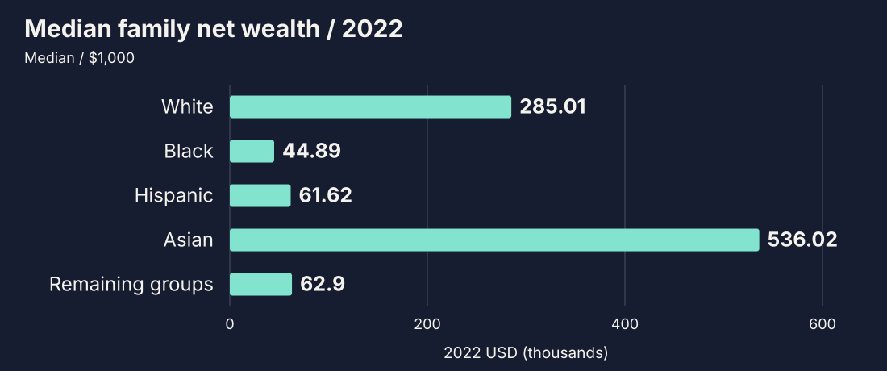
</figure>

Who can absorb an unpaid internship, a move, or a gap between paychecks?

<a href="https://www.federalreserve.gov/econres/notes/feds-notes/greater-wealth-greater-uncertainty-changes-in-racial-inequality-in-the-survey-of-consumer-finances-20231018.html">Federal Reserve / 2022 Survey of Consumer Finances</a>, published Oct 2023. Group medians and point estimates, not individual predictions or 2026 values.

<!--
The Federal Reserve's Figure 1 accessible data give medians in thousands of
2022 dollars: White 285.01, Black 44.89, Hispanic 61.62, Asian 536.02, and
remaining groups 62.9. Include every published group rather than choosing
categories to create a simple hierarchy. The remaining category includes
American Indian, Alaska Native, Native Hawaiian, Pacific Islander, other race,
and multiple-race families. The categories conceal substantial within-group
variation. The 2022 oversample first allowed a separate Asian estimate.
These are survey point estimates with sampling uncertainty; uncertainty values
are retained in research-sources.json. Medians describe families, not every
person in a racial group; wealth is different from income and personal merit.
Do not ask people to reveal their finances or infer an individual's resources
from their race. The practical questions are illustrative, not survey findings.
-->

---

<!-- _class: journey resilience-slide -->

CLASS / THE COST OF AN UNEXPECTED $400

## "Just pay first" assumes a cushion.

Two different findings about a hypothetical emergency expense.

<article class="panel">
63%
<h3>Would use cash or its equivalent.</h3>

Cash, savings, or a credit card paid off at the next statement.
</article>
<article class="panel">
12%
<h3>Could not pay it by any means.</h3>

A different question from choosing not to use cash.
</article>

These are not complementary groups. The other 37% are not all unable to pay.

<a href="https://www.federalreserve.gov/publications/2026-economic-well-being-of-us-households-in-2025-savings-investments.htm">Federal Reserve / SHED 2025</a>, published May 2026. Oct 17-28, 2025 fieldwork; 12,934 adults in the final weighted U.S. sample.

<!--
SHED 2025 is a probability-based Ipsos KnowledgePanel survey, weighted to U.S.
adults 18 and older. 13,099 completed; 12,934 were retained for the report.
63% would cover a hypothetical $400 emergency exclusively with cash or its
equivalent. A card repaid at the next statement counts as cash equivalent.
12% could not pay by any means. Do not equate the 37% choosing other methods
with inability to pay. These are not two exhaustive response categories.
The source notes that choosing a payment method does not prove lack of cash.
This is 2025 fieldwork in a 2026 report, not a financial assessment of the room.
Move from the statistic to a process: direct booking and advances can remove
the requirement to front an organization's expenses. They are suggestions,
not outcomes evaluated by SHED.
-->

---

<!-- _class: journey diagram-slide -->

MAKE THE BARRIER VISIBLE / AN ILLUSTRATIVE PROCESS

## The same invitation. A different price of entry.

<figure class="process-figure">
<figcaption>Illustrative paths, not measured durations or a ranking of people.</figcaption>
</figure>

Change the process: direct booking, advances, paid time, and workable remote options.

<!--
This original teaching diagram applies the financial-resilience evidence.
It is not a measured comparison of timelines, an experimentally estimated
effect, or a claim that everyone offered reimbursement cannot participate.
Some participants also face caring costs, visa restrictions, religious
observance, language barriers, or inaccessible travel. Ask privately about
requirements; do not make someone prove hardship in front of colleagues.
An advance is one possible remedy, not a substitute for checking other barriers.
-->

---

<!-- _class: journey evidence-slide -->
<!-- _transition: slide 450ms -->

A HISTORICAL LENS / REPRESENTATION IN GAMING

## Who gets to be the default?

DiamondLobby's 2021 report / selected games released in 2017-2021, not today's industry.

<figure class="evidence-chart">
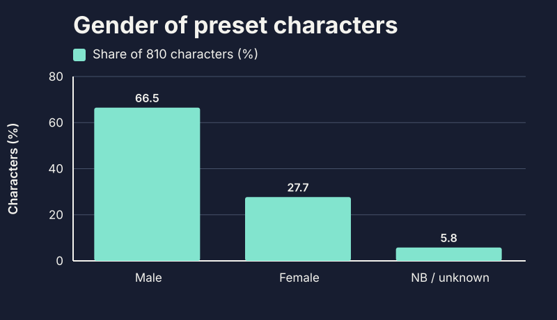
<figcaption>810 preset characters / gender analysis.</figcaption>
</figure>

<article>
66.5%
<h3>Were male.</h3>
27.7% female; 5.8% non-binary or undocumented gender.
</article>
<article><b>KEEP THE CATEGORIES</b><h3>Combined is not separate.</h3>
The 5.8% cannot measure either group separately.
</article>

Source: <a href="https://diamondlobby.com/geeky-stuff/diversity-in-gaming/">DiamondLobby / Diversity in Gaming</a> (page updated Feb 22, 2023). 93 selected games; 810 characters in the gender analysis. Ethnicity: human / human-like subset, size unstated.

<!--
Recreated from the two DiamondLobby graphics embedded in the PowerPoint;
verified against the publisher's article. Reproducible chart specs and source
metadata live in slides/assets/gaming-*.json. Static SVGs render without JS.
The report selected major releases and excluded games with only fully
customizable characters. It is not a representative census of all video games.
The 5.8% combines non-binary and undocumented gender: do not call it a
non-binary representation rate. The ethnic categories obscure differences
between groups and do not capture every aspect of identity.
The original character-collage image is not reproduced; the data is redrawn
with direct attribution rather than reusing unverified character artwork.
-->

---

<!-- _class: journey evidence-slide -->

A HISTORICAL LENS / ETHNIC REPRESENTATION IN GAMING

## What does "everyone else" hide?

DiamondLobby's 2021 report / selected games released in 2017-2021.

<figure class="evidence-chart">
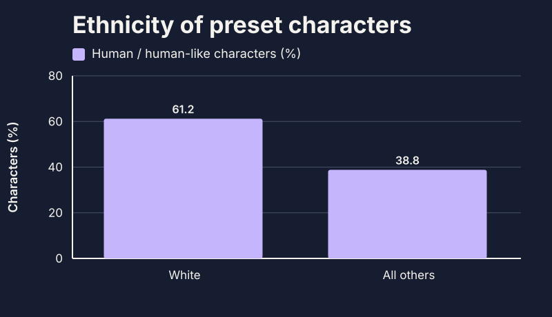
<figcaption>Human or human-like characters only / subset size unstated.</figcaption>
</figure>

<article>
61.2%
<h3>Were white.</h3>
38.8% were grouped as all other ethnicities combined.
</article>
<article><b>LOOK INSIDE THE GROUPING</b><h3>Not one experience.</h3>
The combined category hides differences between groups.
</article>

<a href="https://diamondlobby.com/geeky-stuff/diversity-in-gaming/">DiamondLobby / Diversity in Gaming</a>. Historical selected-game sample, not today's industry. Do not use the 810-character gender denominator for this subset.

<!--
Previously selected with the Ethnicity button; now the next slide.
The source's ethnic analysis includes only human or human-like characters and
does not state that subset's size. Do not infer it from the gender sample.
The grouping obscures distinct communities and does not capture every identity.
This descriptive comparison does not establish causes or changes over time.
-->

---

READ THE EVIDENCE / KEEP THE DENOMINATORS

## A percentage is not the whole story.

<article class="enter"><b>CHARACTERS</b>
66.5%
<h3>Were male.</h3>
Share of 810 preset characters in the gender analysis.
</article>
<article class="enter"><b>GAMES</b>
31.7%
<h3>Had only male characters.</h3>
5% had only female characters; 63.3% had both.
</article>
<article class="enter"><b>ETHNIC REPRESENTATION</b>
9.5%
<h3>Had only white playable characters.</h3>
5.3% had no playable white character, as reported by the study.
</article>

Ask what was sampled, what was excluded, and whose experiences the categories hide.

Historical figures, not current estimates. <a href="https://diamondlobby.com/geeky-stuff/diversity-in-gaming/">DiamondLobby / 2021 report</a>. Character shares and game shares are different measures.

<!--
Preserves the additional percentages in the source deck's gaming infographics.
The study's wording of gender and ethnic categories is reported, not endorsed
as an exhaustive taxonomy. Do not infer the ethnic subset denominator from
the 810-character gender sample. These descriptive results do not establish
causes, individual intent, player demographics, or change over time.
Facilitate discussion: whose story is familiar, whose is exceptional, and how
might that affect the assumptions we carry into another setting?
-->

---

<!-- _class: journey original-graphics -->

FROM THE ORIGINAL DECK / THE GAMING INFOGRAPHICS

## See the representation gap.

Who sees themselves as ordinary, rather than exceptional?

<figure>
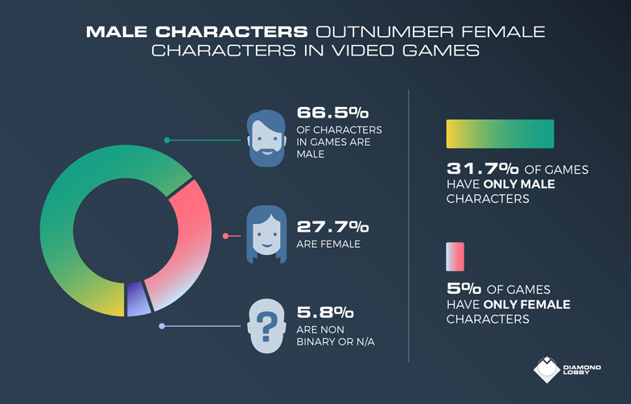
<figcaption>Gender / preset characters and game-level representation.</figcaption>
</figure>
<figure>
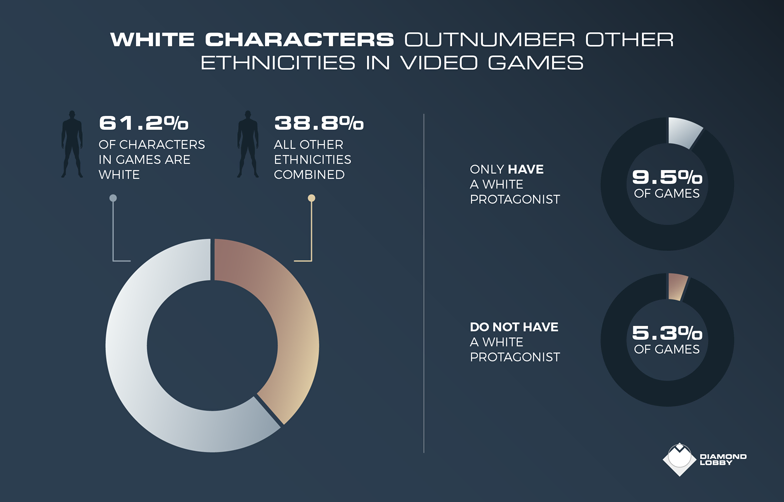
<figcaption>Ethnicity / human or human-like characters only.</figcaption>
</figure>

Historical 2021 report, selected 2017-2021 releases. Original graphics: <a href="https://diamondlobby.com/geeky-stuff/diversity-in-gaming/">DiamondLobby</a>. The categories and sampling limitations still apply.

<!--
The original DiamondLobby graphics are kept intact alongside the redrawn
charts. Images extracted unchanged from the user-provided PowerPoint: slide 11,
ppt/media/image24.png (gender) and image23.png (ethnicity). The publisher's
logos remain visible. These are historical illustrations, not updated figures.
The original ethnic graphic uses "protagonist"; the current source article
describes playable characters. Do not combine that wording into a new measure.
The redrawn charts and preceding source notes explain the sample,
the combined NB/unknown category, and the unspecified ethnic-subset size.
-->

---

<!-- _class: journey evidence-slide -->

A CURRENT LENS / U.S. PLAYERS / ESA 2026

## The audience is bigger than the stereotype.

Who plays today is a different question from who appears in a game.

<figure class="evidence-chart">
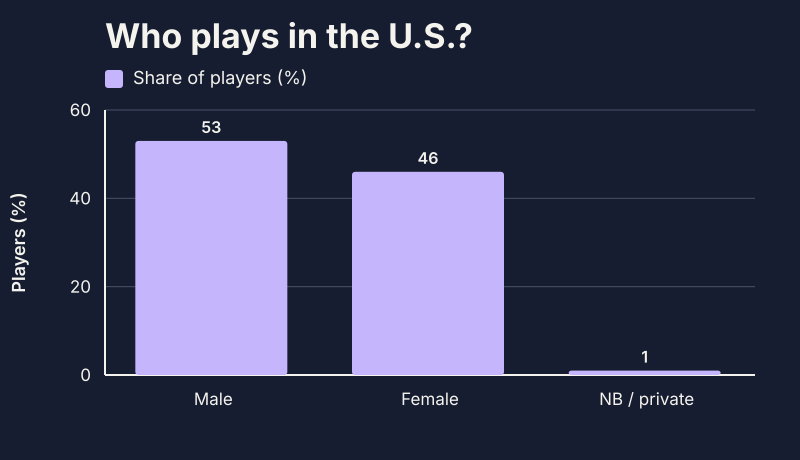
<figcaption>The 1% combines non-binary and prefer not to say.</figcaption>
</figure>

<article class="enter">
212.3M
<h3>U.S. players</h3>
Ages 5-90 / at least one hour per week.
</article>
<article class="enter">
37
<h3>Average player age</h3>
Not only children. Not one kind of person.
</article>

A new population, not a before-and-after chart of character representation.

<a href="https://www.theesa.com/resources/essential-facts-about-the-us-video-game-industry/2026-data/">ESA / Essential Facts 2026</a>, pp. 6, 8, 41. YouGov: 13,545 respondents, Feb 2026; weighted U.S. estimates. Player population estimate is not the survey sample size.

<!--
New primary source checked November 3, 2026. YouGov surveyed 13,545 people
February 11-25, 2026: 9,932 players and 3,613 adult non-players. Household
reporting sizes players as young as 5; players 8-17 answered under parental
supervision. Weighted by age, gender, ethnicity, education, census region
and player status. At least one hour per week on any supported platform.
The estimated population is 212.3 million, not 212.3 million survey respondents.
The source's terms male/female are reported as published. Non-binary and
prefer not to say are combined; do not call the 1% a non-binary identity rate.
The current U.S. player population cannot establish that representation in
games improved since DiamondLobby's selected 2017-2021 character sample.
Ask: which assumptions about "the typical player" should we question?
Source PDF and caveats: slides/assets/research-sources.json.
-->

---

<!-- _class: journey evidence-slide -->

LISTEN TO THE PLAYERS / GEENA DAVIS INSTITUTE + NIELSEN

## Representation is something players notice.

"I am more likely to play a video game if the playable characters are diverse."

<figure class="evidence-chart">
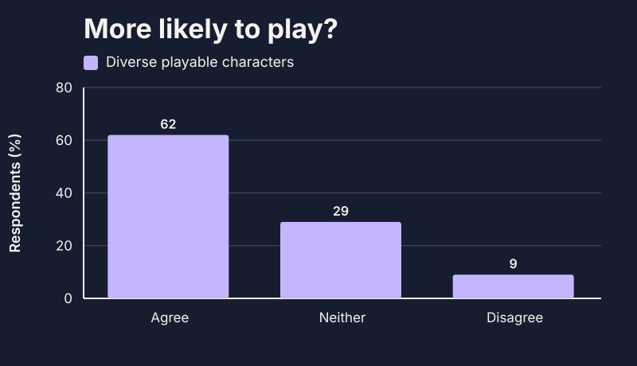
<figcaption>Neither = 100 - 62 - 9. Stated preference, not sales.</figcaption>
</figure>

<article class="enter">
62%
<h3>Agree.</h3>
U.S. and U.K. gamer respondents.
</article>
<article class="enter"><b>ASK, DO NOT ASSUME</b><h3>Whose story is missing?</h3>
Listen to people beyond the audience you imagined.
</article>

<a href="https://geenadavisinstitute.org/wp-content/uploads/2025/04/GDI-March-2025_Ready-Players-All_What-Do-Gamers-Have-to-Say-About-Character-Diversity.pdf">Ready Players All / March 2025</a>, pp. 1-2. Nielsen fieldwork: June 10-15, 2024. The short report does not state sample size; this is not a character census or a measured sales effect.

<!--
The 2025 Geena Davis Institute report uses Nielsen's weekly Video Game Tracking
of U.S./U.K. gamers. It reports 62% agree and 9% disagree with the displayed
statement; all others neither agree nor disagree, so the 29% is a calculated
remainder, not an independently published estimate.
The short report does not specify the respondent count, weighting, or margin
of error. Keep that limitation visible rather than inventing a sample size.
Do not treat stated likelihood as observed game play or purchasing, or claim
this proves that any specific representation decision increases revenue.
This evidence is about preferences, ESA is about player demographics, and
DiamondLobby is about selected game characters. The three are distinct lenses,
not comparable time-series points.
-->

---

<!-- _class: journey evidence-slide -->

REPRESENTATION / VOICE AND DECISION-MAKING POWER

## Being in the story is not the same as shaping it.

Women and girls on screen; women in creative roles / 100 top films of 2025.

<figure class="evidence-chart evidence-chart-wide">
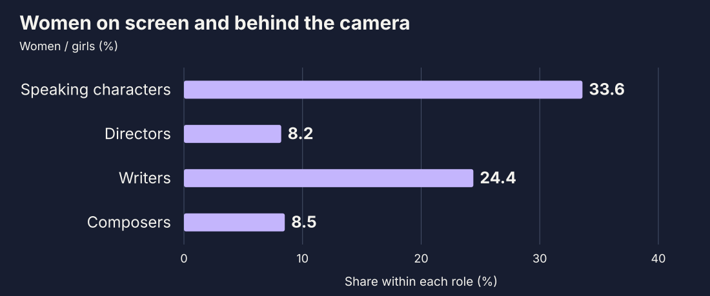
</figure>

Visibility / voice / decision-making power: ask about all three.

<a href="https://assets.uscannenberg.org/aii/inequality1900films_080526.pdf">USC Annenberg Inclusion Initiative / August 2026</a>, graphic pp. 1, 3. Each bar has a different role-specific denominator; not shares of one pool or a census of all film.

<!--
Primary report: Inequality in 1,900 Popular Films, Stacy L. Smith and USC
Annenberg Inclusion Initiative, August 2026, studying 100 top-performing
U.S. theatrical films each year from 2007-2025. The displayed data are 2025.
Of 4,333 speaking/named characters, 1,455 were girls/women (33.6%).
Women: directors 9/110 (8.2%); writers 46 (24.4%); composers 10 (8.5%).
Each percentage uses its own role denominator. These are not a pipeline,
transition probabilities, or comparable percentages of the same workforce.
Do not claim these figures explain a specific creative decision, reflect all
media, or establish that a director's identity causes a particular portrayal.
Representation also includes depth, stereotypes, agency, and working conditions;
presence counts do not measure those qualities. Ask who is missing from your
own product research, design review, accessibility work, and decision table.
-->

---

<!-- _class: journey evidence-slide -->

REPRESENTATION / WHAT AN AVERAGE CAN HIDE

## Absence has intersections.

Out of 100 top films in 2025, how many had no speaking characters from each group?

<figure class="evidence-chart evidence-chart-wide">
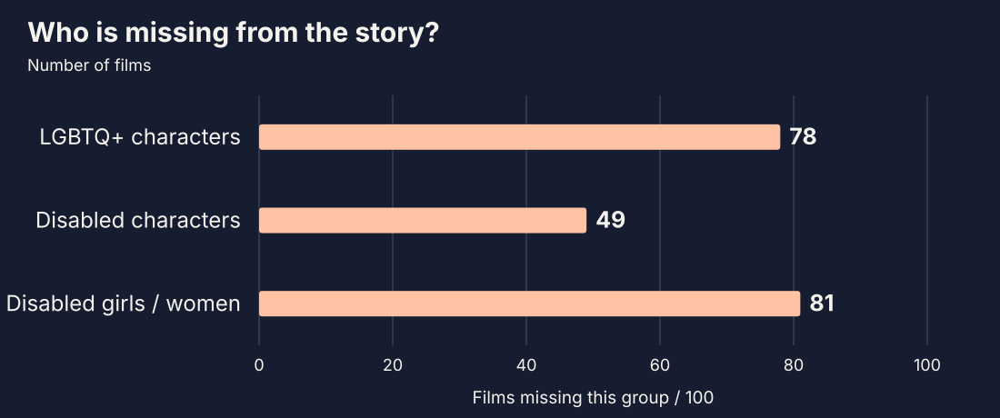
</figure>

A broad inclusion count can still leave a group almost invisible.

<a href="https://assets.uscannenberg.org/aii/inequality1900films_080526.pdf">USC Annenberg / August 2026</a>, graphic pp. 2-3. Film-level absence, not character shares. Films and categories overlap; do not add the bars.

<!--
The report counts 78 films missing LGBTQ+ speaking characters, 49 missing
characters with disabilities, and 81 missing girls/women with disabilities.
All three counts refer to the same set of 100 films from 2025.
The third category is contained within disability representation, while LGBTQ+
and disability categories can overlap. They are not mutually exclusive groups.
These are absence counts, not a claim that 78% of characters are LGBTQ+ or
that a certain percentage of the real population should appear in every film.
Bridge to intersectionality without treating it as simply adding categories:
ask which combinations of experience vanish when only a broad total is used.
Preserve Crenshaw's Black feminist legal context on the following slide.
-->

---

03 / INTERSECTIONALITY

## One label cannot tell the whole story.

Social and political identities interact with systems of power, creating distinct experiences of discrimination and privilege.

Race + ethnicityGenderDisabilityClassSexualityCitizenship

Not a points system. Not "everyone in this group has the same experience."

Kimberlé Crenshaw / coined the term in 1989. <a href="https://www.ted.com/talks/kimberle_crenshaw_the_urgency_of_intersectionality">The Urgency of Intersectionality</a>.

<!--
The original PowerPoint uses a wheel of power/privilege after its definition.
The following slide retains that original diagram. These labeled lenses
introduce the idea without making a fixed ranking of individuals.
Crenshaw's 1989 essay: "Demarginalizing the Intersection of Race and Sex:
A Black Feminist Critique of Antidiscrimination Doctrine, Feminist Theory
and Antiracist Politics." Its Black feminist and legal context matters.
Do not reduce intersectionality to a list of differences or an additive score.
-->

---

<!-- _class: journey wheel-slide -->

THE WHEEL OF POWER / PRIVILEGE

## Power has more than one axis.

<figure class="wheel-figure">
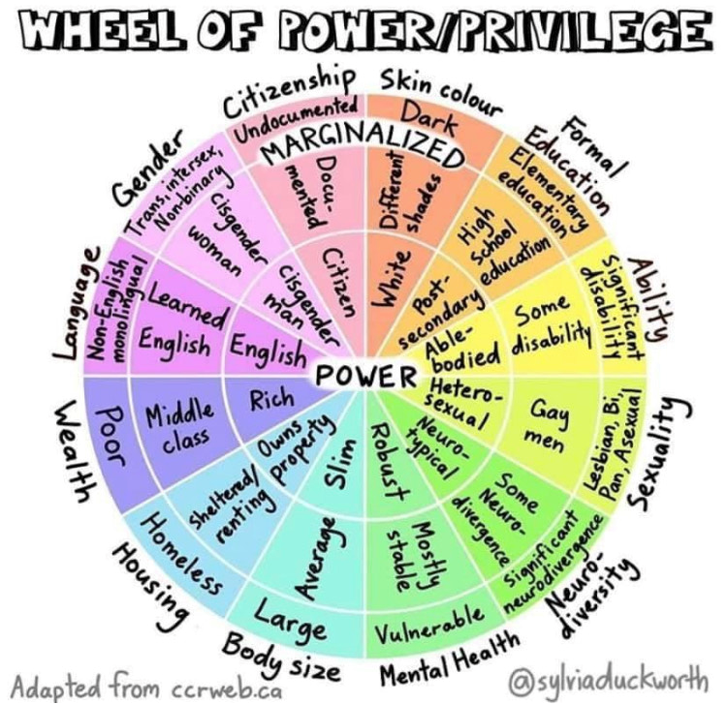
<figcaption><a href="https://www.flickr.com/photos/sylviaduckworth/50500299716/">Sylvia Duckworth</a>, adapted from <a href="https://ccrweb.ca/">ccrweb.ca</a>. Original image / <a href="https://creativecommons.org/licenses/by-nc-nd/2.0/">CC BY-NC-ND 2.0</a>.</figcaption>
</figure>

<b class="panel-label">A REFLECTION TOOL, NOT A PERSONAL SCORE</b>
<h3>Read across the spokes.</h3>

Where might barriers overlap? Consider a lens without placing anyone on the wheel.

<h3>Notice the context.</h3>
Language, access needs, housing, and gender can interact with the same process in different ways. Ask whose participation the default makes easier.

The categories simplify complex lives. Context changes power; a diagram cannot define a person.

<!--
Original image from slide 13, ppt/media/image26.png, reproduced without cropping,
recolouring, overlays, or changes to its labels and embedded creator credit.
Credit: Sylvia Duckworth, adapted from the Canadian Council for Refugees.
Author's upload: https://www.flickr.com/photos/sylviaduckworth/50500299716/
Licence: https://creativecommons.org/licenses/by-nc-nd/2.0/
This third-party artwork is not covered by the repository's MIT licence.
Observe its noncommercial/no-derivatives terms for redistribution or other use.
The prompts sit alongside the unchanged image; they are new teaching examples,
not part of Duckworth's artwork. No personal identity mapping or score is stored.
Some labels are broad or dated. Use the wheel to open questions about systems,
not to assert that an identity has the same power in every country or context.
-->

---

WHEEL LENSES / LANGUAGE + ABILITY

## What does participation assume?

<article class="panel"><b>LANGUAGE</b><h3>Whose fluency is assumed?</h3>
A fast, jargon-heavy meeting can favour some participants. Share an agenda, explain unfamiliar terms, and offer written ways to contribute.
</article>
<article class="panel accent"><b>ABILITY</b><h3>What does access require?</h3>
The same room or tool may be accessible to one person and a barrier to another. Build in captions and accessible formats without demanding public disclosure.
</article>

Change the conditions, not the person. Ask privately about remaining needs.

<!--
These examples previously appeared through the Language and Ability buttons.
They are teaching prompts alongside the unchanged wheel, not modifications to
Duckworth's artwork or claims about anyone in the room. Needs can overlap.
Advance normally; no lens selection or personal disclosure is required.
-->

---

WHEEL LENSES / HOUSING + GENDER

## Which defaults make belonging easier?

<article class="panel"><b>HOUSING</b><h3>What stability is assumed?</h3>
A quiet room, reliable connectivity, or a permanent address is not universal. Ask what the process actually requires and offer workable alternatives.
</article>
<article class="panel accent"><b>GENDER</b><h3>Whose belonging is presumed?</h3>
A form, dress expectation, or leadership stereotype can signal who belongs. Use relevant criteria, inclusive language, and space for self-description.
</article>

Context changes power. No label tells you everything about a person's life.

<!--
These examples previously appeared through the Housing and Gender buttons.
Do not infer housing conditions or gender from someone's appearance or choices.
The examples are illustrative, not a hierarchy, score, or universal experience.
Preserve the distinction between private support and forced disclosure.
-->

---

<!-- _class: journey evidence-slide -->

THE FIRST CAREER STEP / WOMEN IN THE WORKPLACE 2025

## The same rung is not the same climb.

Promotion to manager / rate index, with men set to 100.

<figure class="evidence-chart evidence-chart-wide">
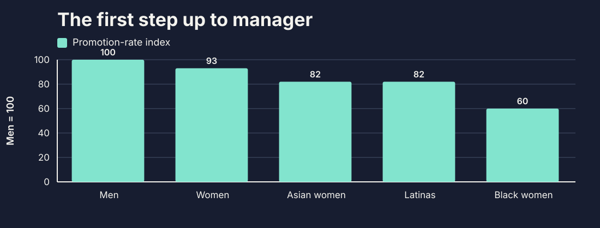
</figure>

Look beyond the average. Ask where the process loses people.

<a href="https://leanin.org/report/women-in-the-workplace/">LeanIn.Org + McKinsey / 2025 report</a>, pp. 18, 50-51. Calendar-year 2024 promotions; voluntary U.S./Canada company sample. Overlapping groups, not shares of all promotions.

<!--
This is the report's "broken rung" comparison, not a claim that 93% of
promotions went to women. Promotion rates use the number promoted into a
level divided by the number of employees of that group at the level below
at the start of the year. Company results are averaged within industries
and weighted to Fortune 500 industry composition; men are normalized to 100.
Women overall includes Asian women, Latinas, Black women, and other groups.
These are not mutually exclusive bars and must not be added together.
The 2025 publication describes personnel movements during 2024, not 2025.
The study's 124 participating organizations were voluntary participants.
The authors note higher women's representation in this year's company sample
than in typical companies participating in 2021-2024. Do not extrapolate to
all employers or treat a disparity as proof of individual intent or causation.
Bridge from the wheel: a broad gender average can obscure different patterns
at the intersection of gender and race. Ask about criteria, access to stretch
work, nominations, and who gets reviewed. Do not diagnose individual employees.
-->

---

<!-- _class: journey evidence-slide -->

INTERSECTIONAL EXPERIENCES / LGBTQ+ WORKERS

## The broad label hides different risks.

Self-reported workplace discrimination in the past year / summer 2023 survey.

<figure class="evidence-chart">
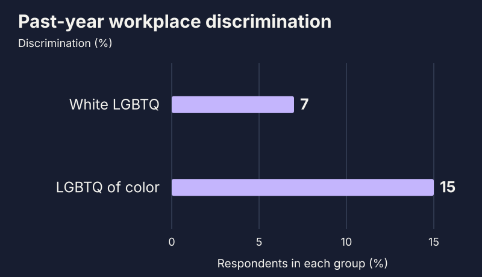
<figcaption>Discrimination, not the combined harassment measure.</figcaption>
</figure>

<article class="enter">
22% vs 9%
<h3>A second lens.</h3>
Trans / nonbinary respondents versus cisgender LGBQ respondents.
</article>
<article class="enter"><b>KEEP THE CONTEXT</b><h3>Not separate boxes.</h3>
Race and gender overlap. Do not add these groups.
</article>

<a href="https://williamsinstitute.law.ucla.edu/publications/lgbt-workplace-discrimination/">Williams Institute / August 2024</a>. 1,902 LGBTQ adults in the workforce, surveyed summer 2023; overall sample, not each subgroup's size. Descriptive self-reports, not causal estimates.

<!--
The August 2024 report distinguishes discrimination, harassment, and their
combined measure. Use past-year discrimination consistently: White LGBTQ 7%,
LGBTQ people of color 15%, cisgender LGBQ 9%, trans/nonbinary 22%.
Do not substitute the 47% lifetime discrimination-or-harassment figure or the
17% past-year combined figure. 1,902 is the full survey, not a subgroup count.
The race comparison and gender comparison overlap: for example, respondents
can be both trans and people of color. No intersection-specific rate can be
calculated by adding, multiplying, or subtracting these published percentages.
Self-reports describe respondents' experiences, not proof of any person's
intent or a causal estimate of gender, race, or disclosure.
-->

---

A CONTEXT CHECK / SAME PROCESS, DIFFERENT BARRIERS

## "Everyone is invited" is only the start.

<article class="enter"><b>A TEAM SOCIAL</b><h3>After hours. At a bar.</h3>
Who has caring commitments, access needs, or reasons not to drink?
</article>
<article class="enter"><b>A MEETING</b><h3>Fast talk. No agenda.</h3>
Who needs processing time, captions, or another way to contribute?
</article>
<article class="enter"><b>A CAREER MOMENT</b><h3>"Just network with leaders."</h3>
Who already has access, introductions, and the benefit of the doubt?
</article>

Design for more than one experience. Ask instead of assuming.

<!--
Fictional discussion examples added to apply the original intersectionality
concept. Do not diagnose anyone's identity from their preferences. A person's
needs may be private, contextual, or unrelated to the identities you can see.
-->

---

<!-- _class: journey access-slide -->

INCLUSION HAS A DESIGN / DELOITTE 2024

## An invitation is not the same as access.

<figure class="community-photo">
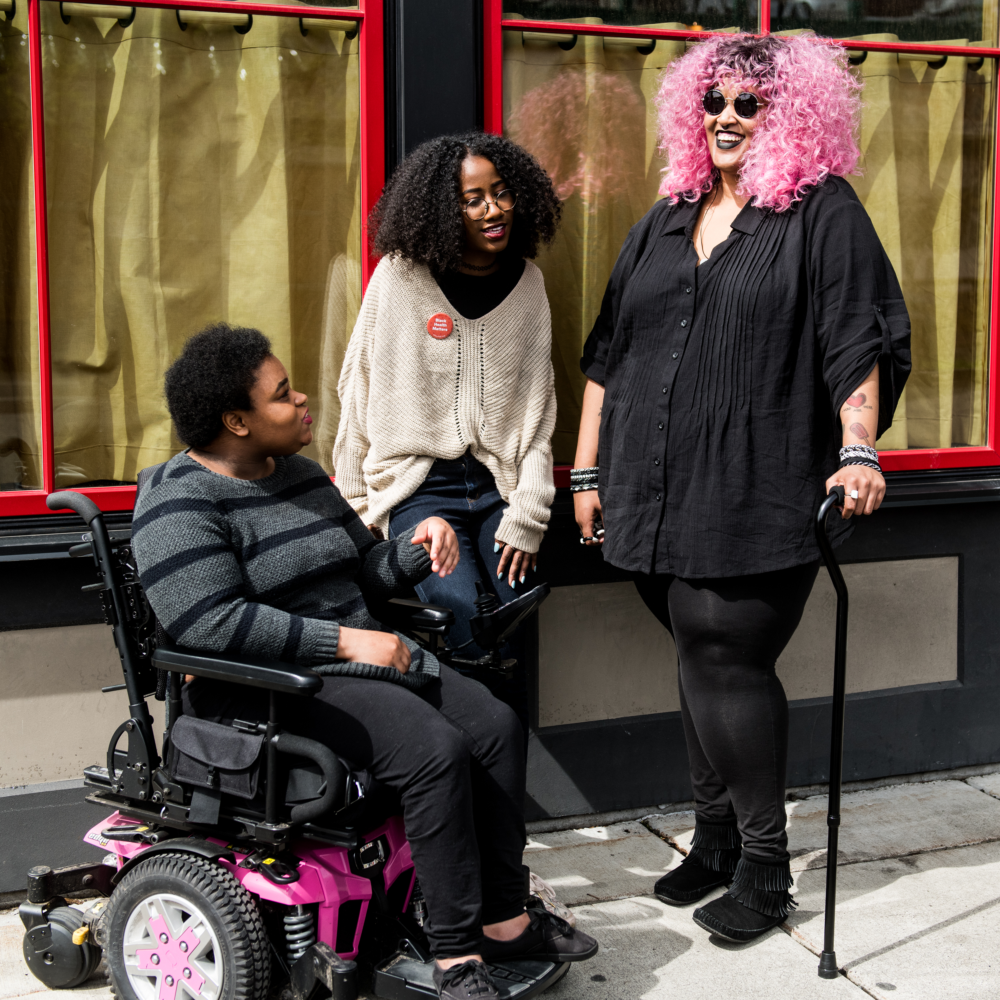
<figcaption><a href="https://affecttheverb.com/gallery/disabledandhere/outdoorgroupconvo/">Disabled And Here</a> / Chona Kasinger / <a href="https://creativecommons.org/licenses/by/4.0/">CC BY 4.0</a>. Illustrative photo.</figcaption>
</figure>

<i></i><i></i><i></i><i></i><i></i><i></i><i></i><i></i><i></i><i></i>

60%

<h3>Missed a work event because of access barriers.</h3>

Respondents with disabilities, chronic health conditions, or neurodivergence.

Venue + restroomsBreaks + quiet spaceCaptions + formats

<a href="https://www.deloitte.com/global/en/issues/work/content/disability-inclusion-at-work.html">Deloitte / Disability Inclusion @ Work 2024</a>. 10,000 employed respondents across 20 countries; Jan-Apr 2024 fieldwork. Self-reported experience, not 60% of all workers or events.

<!--
Deloitte's December 3, 2024 release and report summary say six in ten
respondents have been unable to attend some kind of work event due to
accessibility challenges. The employed survey population includes people
with disabilities, chronic health conditions, or neurodivergence, including
people reporting activity difficulties without adopting a disability label.
This is neither a 2026 estimate nor a percentage of events that are inaccessible.
The photographed people are not identified as respondents or as having
missed an event. Use the image as a depiction of everyday community, not
as evidence about their employment, needs, feelings, or personal histories.
Source page supplies the identities in the alt text. Photograph displayed
in full, unaltered: Disabled And Here, photographer Chona Kasinger, CC BY 4.0.
The access checks are teaching suggestions, not additional survey findings.
Ask the audience to identify a barrier in their own event plan, not to infer
the pictured people's needs. Provide private ways to request accommodations.
-->

---

<!-- _class: journey evidence-slide -->

DIGITAL ACCESS / THE DEFAULT IS SOMETIMES A BARRIER

## Inclusion is also something we ship.

Automated checks of one million popular home pages / February 2026.

<figure class="evidence-chart">
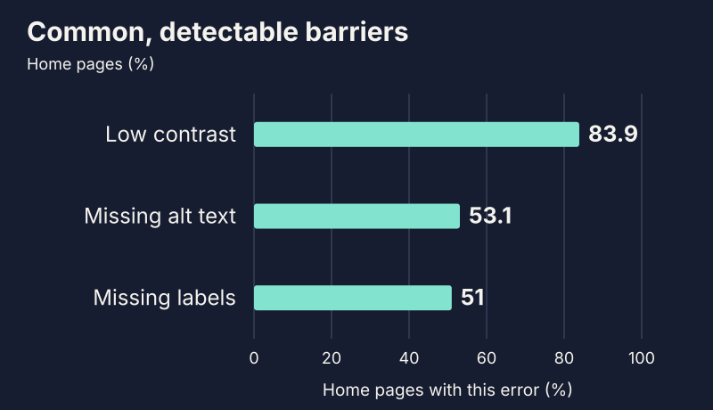
<figcaption>Three common error types. Categories overlap.</figcaption>
</figure>

<article class="enter">
95.9%
<h3>Had detected WCAG failures.</h3>
Top home pages, not all websites.
</article>
<article class="enter"><b>TEST WITH PEOPLE, TOO</b><h3>Zero detected is not accessible.</h3>
Automation finds only some barriers.
</article>

Test contrast, text alternatives, labels, keyboard use, and real tasks.

<a href="https://webaim.org/projects/million/">WebAIM Million / 2026</a>. WAVE analysis of rendered home pages from the Tranco ranking. Automated findings are not a complete conformance assessment.

<!--
WAVE evaluated rendered DOMs after scripts and styles. 95.9% of tested home
pages had automatically detectable WCAG 2 A/AA failures. The displayed error
types are percentages of pages, not percentages of all errors or all users.
A page can have multiple types, so the bars must not be summed.
The report says absence of detected errors does not indicate accessibility
or conformance. Manual testing and disabled users' input remain important.
The action list is a teaching checklist, not a claim that fixing three error
types guarantees access. Make accessibility part of design, procurement,
acceptance criteria, and regression work, not a volunteer side project.
-->

---

<!-- _class: journey covering-photo-slide -->

04 / COVERING

## The effort of editing yourself to belong.

<figure class="community-photo">
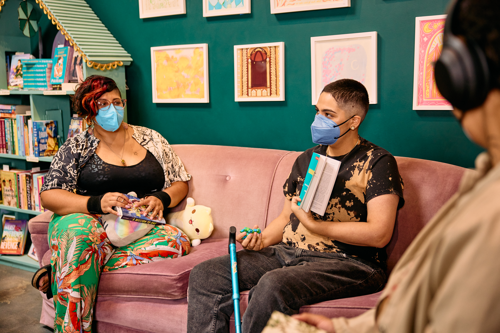
<figcaption><a href="https://affecttheverb.com/gallery/disabledandhere/booktalkoncouch/">Disabled And Here</a> / Gritchelle Fallesgon / <a href="https://creativecommons.org/licenses/by/4.0/">CC BY 4.0</a>. Illustrative photo.</figcaption>
</figure>

<b class="panel-label">WHAT COVERING CAN MEAN</b>

Downplaying a stigmatized part of an identity to reduce the risk of bias or exclusion.

"Will I fit in?""Can I participate as I am?"

Change the conditions. Do not pressure someone to disclose more.

<!--
The source deck asks whether people have had to alter their hair to be seen
as professional, choose clothes to be taken seriously, hide who they love for
fear of judgment or criminal persecution, change a first or last name, or
downplay invisible disabilities to get an interview.
Preserve these as optional reflection, never a request for public disclosure.
Covering is not the same as all privacy or all adaptation. People choose
what they share; an ally's job is not to demand an "authentic" personal story.
The former visible examples remain useful facilitation prompts:
What you may see: "They fit right in." A name shortened. A partner unmentioned.
An access need left unspoken. What you may miss: the cost of that fit, with
attention spent monitoring safety rather than contributing freely.
The new photo is a visual counterpoint: everyday participation with supports
visible. It is not evidence that these people cover, experience exclusion,
or feel any particular way. Do not invite diagnoses based on appearance.
Photo: Disabled And Here, Gritchelle Fallesgon, CC BY 4.0. Displayed in full.
https://affecttheverb.com/gallery/disabledandhere/booktalkoncouch/
-->

---

<!-- _class: journey covering-photo-slide covering-evidence-slide -->

COVERING / PRIVACY IS NOT A PROBLEM TO SOLVE

## Make belonging safer. Not disclosure compulsory.

<figure class="community-photo">
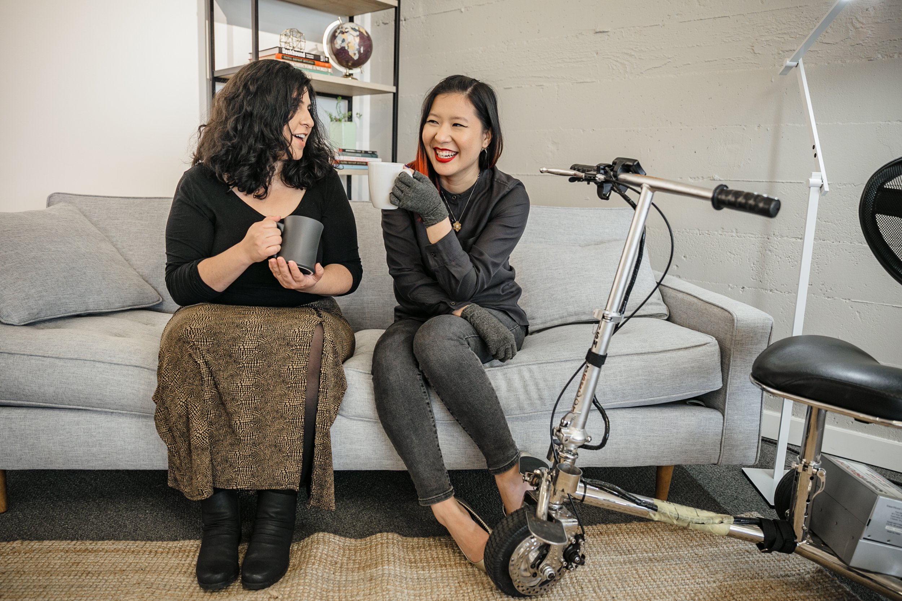
<figcaption><a href="https://affecttheverb.com/gallery/disabledandhere/coffeechat/">Disabled And Here</a> / Tojo Andrianarivo / <a href="https://creativecommons.org/licenses/by/4.0/">CC BY 4.0</a>. Illustrative photo.</figcaption>
</figure>

58%

<h3>Reported covering at their current job.</h3>

LGBTQ respondents described doing so to avoid harassment or discrimination.

Offer private support, consent-based storytelling, and ways to participate without outing anyone.

<a href="https://williamsinstitute.law.ucla.edu/publications/lgbt-workplace-discrimination/">Williams Institute / 2024 report</a>, summer 2023 survey. This is not a measure of all privacy choices. Pictured people are not identified as respondents.

<!--
58% of LGBTQ employees reported engaging in covering behaviors at their
current job to avoid harassment or discrimination. Keep the current-job
measure distinct from past-year discrimination and lifetime experiences.
Examples in the report include changing appearance or behavior or avoiding
discussion of personal life. Privacy is not inherently covering, nor a failure
of authenticity; no colleague owes disclosure to make an organization inclusive.
The photograph depicts a coffee conversation, not covering or workplace risk.
Identities in the alt text come from the collection's own caption. Do not infer
any other identity, feelings, work history, or survey participation.
Photo: Disabled And Here, Tojo Andrianarivo, CC BY 4.0, displayed in full.
-->

---

UNCONSCIOUS BIAS / A PATTERN TO INTERRUPT

## An assumption can arrive before a question.

Learned assumptions, beliefs, or attitudes can influence judgments without conscious awareness.

<article class="enter"><b>NOTICE</b><h3>"Not a culture fit."</h3>
Is this evidence, or familiarity?
</article>
<article class="enter"><b>QUESTION</b><h3>"What criterion?"</h3>
Make the standard explicit and job-relevant.
</article>
<article class="enter"><b>CHANGE</b><h3>"Use the rubric."</h3>
Compare evidence consistently, then review outcomes.
</article>

Good intent is not a substitute for checking impact.

<!--
From the source definition of unconscious bias. The hiring example is new.
Do not use unconscious bias as an excuse for harmful behavior or assume it
explains every disparity. Slowing a decision and using explicit criteria are
practical checks, not guarantees that a process becomes unbiased.
-->

---

<!-- _class: journey hiring-study-slide -->

RACIAL BIAS / TEST THE PROCESS, NOT A GUESS ABOUT INTENT

## What changes when the qualifications do not?

<article class="panel"><b>APPLICATION / RANDOMIZED SIGNAL</b><h3>Black-associated name</h3>
<i></i><i></i><i></i>

Comparable, experimentally varied qualifications.
</article>
<article class="panel"><b>APPLICATION / RANDOMIZED SIGNAL</b><h3>White-associated name</h3>
<i></i><i></i><i></i>

Comparable, experimentally varied qualifications.
</article>

<strong>2.1 percentage points lower</strong> employer-contact probability for Black-associated names.

<a href="https://www.nber.org/papers/w29053">Kline, Rose + Walters / 2022 revision</a>, published in QJE 2022. More than 83,000 fictitious applications; 108 large U.S. employers. A randomized name-signal effect on contact, not offers, a 2.1% relative change, or a current rate for every employer.

<!--
Systemic Discrimination Among Large U.S. Employers, NBER 29053, first issued
July 2021 and revised May 2022; QJE 137(4), 1963-2036 (2022).
The experiment randomized characteristics across more than 83,000 fictitious
applications to 108 large employers. The abstract reports a 2.1-percentage-point
contact penalty for distinctively Black names relative to distinctively white
names. Qualifications were experimentally varied; the illustration communicates
random assignment, not a claim that every resume was literally identical.
The signal is a name perceived as associated with race, not an experiment that
changes a real person's race. Outcomes are employer contacts, not job offers.
Effects varied substantially across companies. This is historical experimental
evidence, not a 2026 hiring census, and it does not identify a psychological
mechanism such as unconscious bias versus deliberate discrimination.
The authors' 2024 A Discrimination Report Card grades 97 employers using this
underlying experiment; it is not a new experiment with 97 employers.
-->

---

<!-- _class: journey statement -->
<!-- _transition: cover 500ms -->

THE SECOND SHIFT

# A **journey.** Not a destination.

Notice. Listen. Act. Reflect. Then choose the next action.

<!--
Preserves the original journey statement. Growth is iterative; it includes
mistakes, feedback, and changing behavior, rather than collecting credentials.
-->

---

AN ALLYSHIP FRAMEWORK / WIDEN THE SCOPE

## One. Some. All.

Keep the personal support. Widen your impact.

<article><b>ALLY FOR ONE</b><h3>Support a person.</h3>
Ask a colleague how they want an interrupted contribution supported. Return credit without taking over.
</article>
<article><b>ALLY FOR SOME</b><h3>Change a team habit.</h3>
Agree on a team habit: agendas in advance, written input, and explicit credit for ideas.
</article>
<article><b>ALLY FOR ALL</b><h3>Change a process.</h3>
Build consistent participation and hiring practices into the process, assign ownership, and review who still faces barriers.
</article>

Ask what helps. Back their choice. Remove the need for repeated rescue.

<!--
The original SmartArt labels are "Ally for One", "Ally for Some", and
"Ally for All". The examples operationalize those labels; they are not a
validated maturity model and do not imply any process serves everyone perfectly.
All readers see all three levels and their concrete examples without selecting.
Keep the personal support. Remove the need for repeated rescue.
-->

---

<!-- _class: journey reflection-slide -->

<figure class="reflection-photo">

<figcaption>Original deck photo / <a href="https://www.pexels.com/photo/oval-brown-wooden-framed-hanging-mirror-1528975/">Pexels</a></figcaption>
</figure>

05 / WHY ME?

## You have a place to start.

<article class="enter"><b>AS A PERSON</b><h3>Grow your perspective.</h3>
Notice what your own experience does not show you.
</article>
<article class="enter"><b>AS A LEADER</b><h3>Use your influence.</h3>
Question the default. Make room. Take responsibility.
</article>
<article class="enter"><b>AS A COLLABORATOR</b><h3>Build better relationships.</h3>
Listen with care. Make your support dependable.
</article>

<!--
Preserves the original motivations: personal growth, becoming a more effective
and empathetic leader, and being a better collaborator. Speak from "for me",
not as a promise of guaranteed personal reward.
The original slide 18 mirror photograph is retained; source:
https://www.pexels.com/photo/oval-brown-wooden-framed-hanging-mirror-1528975/
Notice the experiences missing from your frame of reference, take responsibility
for the conditions, and make support both concrete and dependable.
-->

---

<!-- _class: journey covering-photo-slide training-slide -->

ALLYSHIP / AWARENESS IS A START, NOT THE OUTCOME

## A completed course is not a changed system.

<figure class="community-photo">
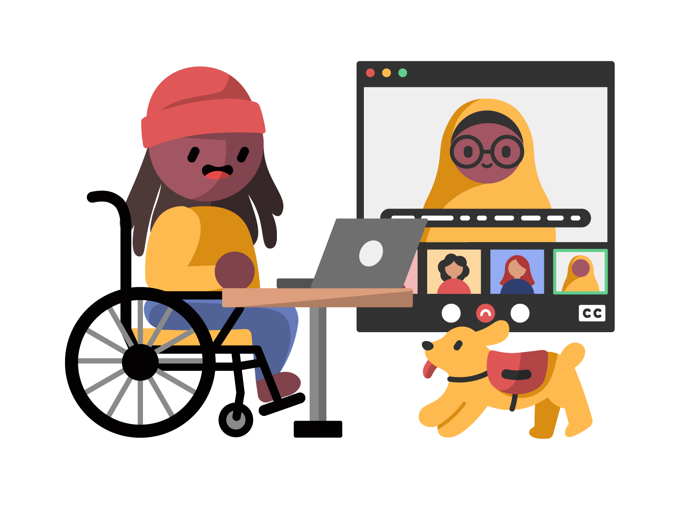
<figcaption><a href="https://affecttheverb.com/gallery/disabledandhere/videocall/">Disabled And Here</a> / Dana Chan / <a href="https://creativecommons.org/licenses/by/4.0/">CC BY 4.0</a>. Illustrative artwork.</figcaption>
</figure>

<b class="panel-label">A RANDOMIZED FIELD EXPERIMENT</b>
<h3>3,016 employees. One global organization.</h3>

A brief online training changed attitudes and some behaviors, but effects varied across groups.

2017 intervention / published 2019. Not a test of every training or every organization.

Learn the idea. Rehearse the response. Change the process. Check what happens.

<a href="https://pmc.ncbi.nlm.nih.gov/articles/PMC6475398/">Chang et al. / The mixed effects of online diversity training / PNAS 2019</a>. Workplace decisions followed for up to 20 weeks. The practical sequence above is a teaching suggestion, not a tested intervention package.

<!--
The preregistered field experiment recruited 3,016 consenting employees from
10,983 invited salaried employees at one global organization in early 2017.
Volunteers were randomized to gender-bias training, general-bias training,
or an active control focused on psychological safety and active listening.
Median completion was 68 minutes. Attitude changes were more apparent in
groups with less supportive baseline attitudes; some behavioral changes
appeared among groups already more supportive. Results are nuanced: do not
summarize the study as "training never works" or a universal success.
The authors describe one-off training as unlikely to be a stand-alone solution.
The four-part practice suggestion is our facilitation synthesis, not a
causally validated model. The illustration depicts accessible participation,
not the experiment or its participants. Credit Dana Chan for Disabled And Here.
-->

---

06 / GET STARTED

## Six practices. No perfect starting point.

<article class="enter"><b>BE CURIOUS</b><h3>Learn first.</h3>
Use resources. Do not make one person your curriculum.
</article>
<article class="enter"><b>LISTEN</b><h3>Believe there is more to hear.</h3>
Understand before defending your interpretation.
</article>
<article class="enter"><b>DECENTER</b><h3>It is not about you.</h3>
Support is not a request for praise.
</article>
<article class="enter"><b>WIDEN</b><h3>More than one experience.</h3>
Ask whose perspective is absent.
</article>
<article class="enter"><b>STAY</b><h3>Be uncomfortable.</h3>
Let feedback change your next action.
</article>
<article class="enter"><b>CHANGE</b><h3>Beyond individuals.</h3>
Fix the pattern, not only the moment.
</article>

<!--
Preserves all six "How do I get started?" points from the source PowerPoint.
Discomfort is not a reason to require someone else to accept harm or to stay
in an unsafe conversation. Learners can pause or pass.
-->

---

<!-- _class: journey diagram-slide -->

RESPONDING TO HARM / RIGHT TO BE'S 5Ds

## There is more than one way to intervene.

<figure class="process-figure options-figure">
<figcaption>Options, not a sequence. Four are indirect; direct confrontation is not the only form of courage.</figcaption>
</figure>

Safety first. Keep support person-led. Never publish documentation without consent.

Framework: <a href="https://righttobe.org/guides/bystander-intervention-training/">Right To Be / The 5Ds of Bystander Intervention</a>. New diagram and condensed teaching labels; not a substitute for training or emergency guidance.

<!--
Right To Be's framework builds on Green Dot's original Three Ds and adds Delay
and Document. These are choices, not a required escalation ladder.
For Direct, assess safety and likely escalation, keep the response brief,
and prioritize the person harmed rather than arguing with a harasser.
Delegate to appropriate support; do not assume police involvement is wanted.
For Document, first ensure someone is helping, assess safety, and ask what the
person wants done with the record. Never post or use it without permission.
Delay means a supportive check-in afterward; it is not an excuse to ignore harm.
Do not ask the audience to reenact personal incidents or share trauma.
-->

---

<!-- _class: journey practice-slide -->

PRACTICE / MEETINGS / 1 OF 6

## An interrupted idea.

Maya starts explaining an idea. Someone interrupts, then presents the same idea as their own.

<article><b>01</b><h3>Stay silent and move on.</h3></article>
<article><b>02</b><h3>Explain Maya's idea for her.</h3></article>
<article><b>03</b><h3>Return the floor and credit Maya.</h3></article>

What would you do next? Reflect or discuss, then advance for the tradeoffs.

Fictional situation. No timer, audience scoring, or responses collected.

<!--
Added in response to the source PowerPoint's request for specific examples:
sponsorship, inclusive hiring, non-inclusive language, and space for quiet voices.
The six exercises offer tradeoffs, not universal scripts or a test of moral worth.
Pause here if useful; passing is welcome. Advance to the debrief without clicking
or selecting anything. In serious or unsafe situations, consider appropriate
support channels and personal safety. These are not measured research outcomes.
-->

---

<!-- _class: journey practice-slide -->

DEBRIEF / AN INTERRUPTED IDEA

## Make space without taking the spotlight.

<article><b>01 / STAY SILENT</b><h3>Silence leaves the pattern intact.</h3>
You may need to assess safety first. When possible, return the floor and credit the original contribution rather than letting it disappear.
</article>
<article><b>02 / EXPLAIN FOR HER</b><h3>Support can become taking over.</h3>
Even a helpful explanation can replace her voice. Ask to hear Maya finish, then check privately what support she wants.
</article>
<article class="accent"><b>03 / RETURN THE FLOOR</b><h3>Credit her. Follow her lead.</h3>
"I want to hear Maya finish that thought." Credit her idea, then follow her lead. Later, address recurring interruption as a team habit.
</article>

<!--
All three formerly selectable responses are visible together, including the
caveat about safety and the private check-in. Do not assume Maya wants a public
intervention or needs someone else to explain her work.
-->

---

<!-- _class: journey practice-slide -->

PRACTICE / HIRING / 2 OF 6

## A vague hiring decision.

A strong candidate is rejected with: "I just don't think they would fit our culture."

<article><b>01</b><h3>Trust the vague gut feeling.</h3></article>
<article><b>02</b><h3>Ask for evidence against the rubric.</h3></article>
<article><b>03</b><h3>Declare the candidate must be hired.</h3></article>

What would you do next? Reflect or discuss, then advance for the tradeoffs.

Fictional situation. Challenge the process without guessing anyone's intent.

<!--
Invite discussion of job-related evidence, not diagnoses of the interviewer's
character. Next reveals all three responses; no selection is needed.
-->

---

<!-- _class: journey practice-slide -->

DEBRIEF / A VAGUE HIRING DECISION

## Make the standard explicit.

<article><b>01 / TRUST THE FEELING</b><h3>Familiarity is not a job criterion.</h3>
Ask what specific job-related evidence supports the decision. A feeling of similarity can hide an inconsistent standard.
</article>
<article class="accent"><b>02 / ASK FOR EVIDENCE</b><h3>Use the rubric consistently.</h3>
"Which criterion is missing, and what evidence supports that?" Apply the same rubric consistently and review whether the process itself creates barriers.
</article>
<article><b>03 / REQUIRE THE HIRE</b><h3>Do not replace one shortcut with another.</h3>
Challenge the vague reasoning without inventing evidence or bypassing a fair assessment. Return to clear, job-relevant criteria.
</article>

<!--
The useful intervention asks which job-related criterion is missing. It is not
a demand to hire without evidence or a guarantee that using a rubric removes
all bias. Review the process as well as an individual decision.
-->

---

<!-- _class: journey practice-slide -->

PRACTICE / LANGUAGE / 3 OF 6

## Excluding language.

A colleague uses a phrase that excludes a group. Nobody else responds.

<article><b>01</b><h3>Briefly suggest inclusive wording.</h3></article>
<article><b>02</b><h3>Ask a teammate to speak for their group.</h3></article>
<article><b>03</b><h3>Only explain that no harm was intended.</h3></article>

What would you do next? Reflect or discuss, then advance for the tradeoffs.

Fictional situation. Nobody is required to represent a group or share a personal story.

<!--
Keep discussion about the behavior and response, not a reenactment of harmful
language. Passing is welcome. Advance for the debrief.
-->

---

<!-- _class: journey practice-slide -->

DEBRIEF / EXCLUDING LANGUAGE

## Repair the wording. Do not assign the burden.

<article class="accent"><b>01 / SUGGEST WORDING</b><h3>Address the wording and keep learning.</h3>
"Let's use language that includes everyone." Offer an alternative, avoid disclosing anyone's identity, and follow up on the pattern if it continues.
</article>
<article><b>02 / ASK A TEAMMATE</b><h3>Do not assign someone the work of representing a group.</h3>
It can put them on the spot or expose private information. Take responsibility for your own intervention and let them decide whether to participate.
</article>
<article><b>03 / EXPLAIN INTENT</b><h3>Intent does not erase impact.</h3>
Acknowledge the wording and adjust it. You do not need to decide someone is a bad person in order to change what was said.
</article>

<!--
Address the wording without speaking for someone else's identity. A concise,
proportionate correction can be useful; keep safety and context in mind.
-->

---

<!-- _class: journey practice-slide -->

PRACTICE / ACCESS / 4 OF 6

## An inaccessible workshop.

Your team schedules a required workshop. The venue has stairs and the videos have no captions.

<article><b>01</b><h3>Ask who has a disability in the group.</h3></article>
<article><b>02</b><h3>Offer the slides to anyone who cannot attend.</h3></article>
<article><b>03</b><h3>Fix the barriers before the workshop.</h3></article>

How can you help without asking people to expose themselves? Advance for the tradeoffs.

Fictional situation. Improve the process without demanding identity or diagnosis evidence.

<!--
These participation exercises are fictional application examples, not survey
cases or tested scripts. Invite discussion of the organizer's choices rather
than personal disclosures. Accommodations should use confidential channels.
-->

---

<!-- _class: journey practice-slide -->

DEBRIEF / AN INACCESSIBLE WORKSHOP

## Build access into the plan.

<article><b>01 / ASK WHO IS DISABLED</b><h3>Do not make disclosure the price of access.</h3>
Describe access options and provide a private contact. Fix the venue and media barriers without asking people to publicly identify themselves.
</article>
<article><b>02 / OFFER A HANDOUT</b><h3>A handout is not equal participation.</h3>
Slides alone miss discussion, relationships, and decisions. Make the workshop accessible, including the venue, captions, and a workable remote option.
</article>
<article class="accent"><b>03 / FIX THE BARRIERS</b><h3>Design participation in, rather than adding a rescue.</h3>
Confirm an accessible venue and restrooms, caption the media, and share formats in advance. Ask privately about remaining needs without requiring a diagnosis.
</article>

<!--
Do not infer disability from appearance or require a public explanation of
access needs. Follow appropriate confidential accommodation processes.
-->

---

<!-- _class: journey practice-slide -->

PRACTICE / PRIVACY / 5 OF 6

## A public identity campaign.

A colleague privately tells you about their partner. A manager asks you to identify LGBTQ+ staff for a public campaign.

<article><b>01</b><h3>Share the name because the campaign is positive.</h3></article>
<article><b>02</b><h3>Suggest an open invitation with explicit opt-in.</h3></article>
<article><b>03</b><h3>Ask the colleague to educate the manager.</h3></article>

What permission do you actually have? Reflect, then advance for the tradeoffs.

Fictional situation. Consent to a private conversation is not consent to publicity.

<!--
Do not infer a colleague's sexuality from their partner or private conversation.
The correct process protects everyone's choice about if and how to participate.
Do not invite audience members to identify LGBTQ+ staff or share private stories.
-->

---

<!-- _class: journey practice-slide -->

DEBRIEF / A PUBLIC IDENTITY CAMPAIGN

## Support without outing.

<article><b>01 / SHARE THE NAME</b><h3>Good intentions do not grant permission to disclose.</h3>
A public campaign can expose someone to risk or attention they did not choose. Do not share names, identity, or private conversations without explicit consent.
</article>
<article class="accent"><b>02 / INVITE AN OPT-IN</b><h3>Make participation voluntary and protect privacy.</h3>
Offer the invitation to everyone, explain where stories or photos will appear, and ask for specific consent. Declining must carry no career penalty.
</article>
<article><b>03 / ASSIGN THE FIX</b><h3>Do not assign someone the work of fixing the process.</h3>
You can question the request yourself without naming the colleague. Make the campaign consent-based, and let people choose if and how they participate.
</article>

<!--
Private support does not authorize public disclosure. Nobody owes an organization
their story, visibility, or the work of educating a manager.
-->

---

<!-- _class: journey practice-slide -->

PRACTICE / FINANCIAL FRICTION / 6 OF 6

## Pay now, reimburse later.

An optional career event requires employees to pay $600 for travel, with reimbursement six weeks later.

<article><b>01</b><h3>Tell people to put it on a credit card.</h3></article>
<article><b>02</b><h3>Ask for a public list of people who cannot pay.</h3></article>
<article><b>03</b><h3>Arrange direct booking or an advance.</h3></article>

Who can afford to say yes? Reflect, then advance for the tradeoffs.

Fictional situation. Do not assume anyone's income, credit, or financial circumstances.

<!--
The $600 and six weeks are fictional scenario details, not research findings.
Discuss the organization's requirement, not participants' financial histories.
Passing is welcome; no answers or hardship stories are collected.
-->

---

<!-- _class: journey practice-slide -->

DEBRIEF / PAY NOW, REIMBURSE LATER

## Remove the up-front requirement.

<article><b>01 / SUGGEST CREDIT</b><h3>Credit is not a universal safety net.</h3>
Available credit, interest costs, and financial risk vary. Do not turn a career opportunity into a test of someone's ability to lend money to the organization.
</article>
<article><b>02 / MAKE A PUBLIC LIST</b><h3>Financial hardship is not a story people owe the team.</h3>
Offer direct booking, advances, or remote participation through a private channel. Avoid requiring public explanations of income, debt, or family circumstances.
</article>
<article class="accent"><b>03 / BOOK OR ADVANCE</b><h3>Change the price of entry.</h3>
Ask the organizer to book travel or provide advances, with clear eligibility and a private contact. Check whether caring costs or timing still block participation.
</article>

<!--
Do not infer that any particular colleague is financially insecure. Remove the
up-front requirement rather than asking people to explain hardship publicly.
An advance is one option, not proof that every remaining barrier is resolved.
All six exercises and all eighteen response explanations are in the slide
sequence, presenter previews, no-JavaScript output, and PDF.
-->

---

USE YOUR ACCESS / SPONSORSHIP

## Say their name in the room they are not in.

<b>MENTORING</b><h3>"Here is some advice."</h3>
Share knowledge, perspective, and encouragement.

<b>SPONSORSHIP</b><h3>"I recommend them."</h3>
Use your credibility to open an opportunity and credit their work.

Ask about their goals. Share context. Make the introduction. Follow through.

<!--
New concrete example requested in the original speaker notes. Sponsorship is
not favoritism: use transparent, job-relevant evidence and widen access rather
than reproducing a closed network. Obtain permission before sharing private
information or committing someone to an opportunity.
-->

---

<!-- _class: journey evidence-slide -->

MAKE OPPORTUNITY VISIBLE / WOMEN IN THE WORKPLACE 2025

## Access to an advocate is not evenly shared.

Entry-level employees who report having a sponsor at work.

<figure class="evidence-chart">
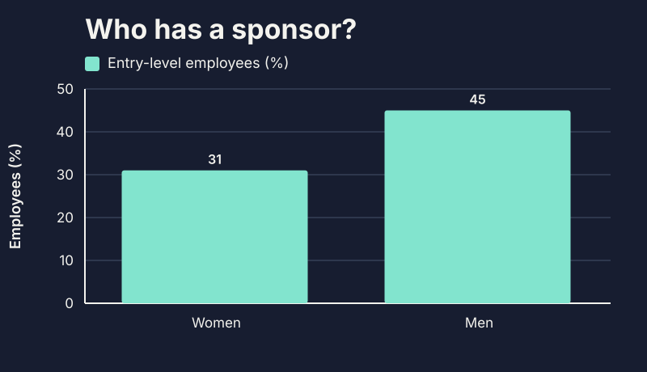
</figure>

<article class="enter">
14pp
<h3>A gap in access.</h3>
Percentage points, not a 14% difference.
</article>
<article class="enter"><b>FROM INTENT TO ACTION</b><h3>Who is on your shortlist?</h3>
Offer a relevant introduction or stretch opportunity. Ask permission first.
</article>

Do not only advise someone. Help open a door.

<a href="https://leanin.org/report/women-in-the-workplace/">LeanIn.Org + McKinsey / 2025 report</a>, pp. 5, 50-52. About 9,500 employee respondents in the overall survey; these figures describe the entry-level subgroup.

<!--
The full question defines a sponsor as someone other than your direct manager
who actively advocates for your career advancement and/or creates opportunities.
31% of entry-level women and 45% of entry-level men report one or more sponsors.
45 minus 31 is 14 percentage points, not a 14% relative difference.
Employee fieldwork: a separate third-party survey panel in July-August 2025.
Do not present the overall survey size as the size of either entry-level group.
This descriptive comparison is not a causal estimate of what sponsorship
will achieve for a particular person. Avoid the tempting claim that adding
a sponsor guarantees a promotion. Transparent criteria and consent still matter.
Facilitate a private reflection: whose work have you observed, who gets named
for an opportunity, and whose access could you widen without assuming their goals?
-->

---

BEYOND A SINGLE MOMENT / CHANGE THE DEFAULT

## Make the better action easier to repeat.

<article class="enter"><b>MEETINGS</b><h3>Multiple ways to contribute.</h3>
Send an agenda. Offer written input. Return credit to the person whose idea it was.
</article>
<article class="enter"><b>HIRING</b><h3>Criteria before candidates.</h3>
Define relevant evidence. Use a consistent rubric. Review where access breaks down.
</article>
<article class="enter"><b>TEAM LANGUAGE</b><h3>A habit of respectful repair.</h3>
Agree on inclusive wording. Correct it without a spectacle. Change recurring templates.
</article>

<!--
These are implementation examples for "Ally for Some / All", drawn from the
source notes' call for inclusive hiring, non-inclusive language, and quiet
voices. Invite input rather than forcing a quiet person to speak publicly.
Accessible formats and accommodations should not depend on public disclosure.
-->

---

<!-- _class: journey diagram-slide accountability-slide -->

ORGANIZATIONAL ALLYSHIP / MAKE THE COMMITMENT CREDIBLE

## A value needs an owner, resources, and feedback.

<figure class="process-figure options-figure">

<figcaption>Catalyst's six organizational characteristics / a relationship map, not a score or guaranteed outcome.</figcaption>
</figure>

Pick one barrier. Name an owner. Fund the change. Review access and outcomes—not only attendance.

<a href="https://www.catalyst.org/insights/2024/genuine-inclusion-policies">Catalyst / Six actions to create genuine DEI policies / July 2024</a>. Panel survey of 2,572 full-time employees in eight countries. Associations with perceived genuineness, not a randomized intervention.

<!--
Catalyst identifies communicating a fairness case, building accountability,
acting with integrity, ensuring alignment, creating transparency, and preventing
a climate of silence. "Room to speak" condenses the last concept, not a claim
that speaking up is always safe or that individuals are responsible for silence.
Full-time respondents were recruited through a panel service in eight countries;
regression analyses were observational. The reported R-squared of .52 is
explained variance, not 52% of employees, a success rate, or an intervention effect.
The practical ownership checklist is a teaching application. Review whether
people can access opportunities and complete tasks; do not collect identifiable
disclosure data or publish small-group outcomes that could expose individuals.
Use voluntary feedback, aggregated information with privacy safeguards, and
appropriate organizational expertise. A public target alone does not ensure access.
-->

---

WHEN YOU GET IT WRONG / REPAIR

## Feedback is a chance to change the pattern.

<article class="enter"><b>01 / LISTEN</b><h3>Do not litigate intent.</h3>
Understand the impact without asking for reassurance.
</article>
<article class="enter"><b>02 / ACKNOWLEDGE</b><h3>Be specific.</h3>
"I interrupted you. I'm sorry. Please finish."
</article>
<article class="enter"><b>03 / CHANGE</b><h3>Follow through.</h3>
Correct what you can. Adjust the habit. Accept that trust takes time.
</article>

An apology is not a request for forgiveness or a public reward.

<!--
New application of "allyship is a journey" and "it is not about you".
Keep repair proportionate. Respect requests for space and do not make someone
repeatedly explain the harm in order for you to take responsibility.
-->

---

<!-- _class: journey commitment-slide -->

YOUR NEXT STEP / REFLECT PRIVATELY

# One action. **This week.**

I will __________ in __________. I will check the impact by __________.

Make space / Credit a contribution / Sponsor someone / Change a process

<figure class="start-photo">

<figcaption>Original deck image / <a href="https://pixabay.com/illustrations/road-start-beginning-intention-368719/">Pixabay</a></figcaption>
</figure>

<!--
Give people a moment to write privately. A useful commitment names an action,
a setting, and a way to learn whether it helped. Do not collect identities or
stories, and do not make sharing a condition of participation.
Retains the START road image from original slide 19; source:
https://pixabay.com/illustrations/road-start-beginning-intention-368719/
-->

---

<!-- _class: journey questions -->

KEEP THE CONVERSATION OPEN

# Questions?

What did you notice? What will you try? What might you need to unlearn?

<!--
Retains the original closing owl. Invite questions without asking members of
marginalized groups to validate the session or represent a whole community.
-->

---

KEEP LEARNING / FOUNDATIONS

## Resources to return to.

<article><b>READ</b><h3><a href="https://guidetoallyship.com/">Guide to Allyship</a></h3>
An open-source starting point for effective, ongoing allyship.
</article>
<article><b>WATCH</b><h3><a href="https://www.ted.com/talks/kimberle_crenshaw_the_urgency_of_intersectionality">The Urgency of Intersectionality</a></h3>
Kimberlé Crenshaw / why a single-axis view misses people's experiences.
</article>
<article><b>EXPLORE THE DATA</b><h3><a href="https://diamondlobby.com/geeky-stuff/diversity-in-gaming/">Diversity in Gaming</a></h3>
DiamondLobby / the historical report behind this deck's charts.
</article>

<!--
Preserves the original first resource slide and adds the source of the
previously image-only gaming data. Source links stay usable in HTML and PDF.
-->

---

KEEP LEARNING / MORE PERSPECTIVES

## Keep reading. Keep questioning.

<article><b>READ</b><h3><a href="https://www.penguinrandomhouse.com/books/566247/white-fragility-by-robin-diangelo/">White Fragility</a></h3>
Robin DiAngelo / examining defensive responses in conversations about racism.
</article>
<article><b>WATCH</b><h3><a href="https://www.ted.com/talks/melinda_briana_epler_3_ways_to_be_a_better_ally_in_the_workplace">3 Ways to Be a Better Ally in the Workplace</a></h3>
Melinda Briana Epler / practical ways to support underrepresented colleagues.
</article>

No single resource is the final word. Seek multiple perspectives, especially from people affected.

<!--
The original resource "How to be a Better Ally to Women", attributed there to
Nilofer Merchant, linked to https://www.youtube.com/watch?v=VzPWjxckoOc .
YouTube's metadata endpoint returned 404 during revision, so the visible list
now uses a verified TED resource by Melinda Briana Epler instead. The original
reference is preserved here for provenance, not presented as a verified talk.
Book and talk descriptions summarize the original resource list, not an
endorsement of every claim or a substitute for a range of perspectives.
-->

---

KEEP LEARNING / UPDATED EVIDENCE + VISUALS

## Follow the source, not just the statistic.

<article><b>PLAYERS / 2026 + 2025</b><h3><a href="https://www.theesa.com/resources/essential-facts-about-the-us-video-game-industry/2026-data/">ESA / Essential Facts</a></h3>
Player demographics + <a href="https://geenadavisinstitute.org/wp-content/uploads/2025/04/GDI-March-2025_Ready-Players-All_What-Do-Gamers-Have-to-Say-About-Character-Diversity.pdf">GDI / Ready Players All</a> on representation preferences.
</article>
<article><b>CAREERS / 2025</b><h3><a href="https://leanin.org/report/women-in-the-workplace/">Women in the Workplace</a></h3>
Sponsorship survey and promotion-rate comparisons; different denominators.
</article>
<article><b>ACCESS / 2024 + OPENLY LICENSED PHOTOGRAPHY</b><h3><a href="https://www.deloitte.com/global/en/issues/work/content/disability-inclusion-at-work.html">Deloitte / Disability Inclusion @ Work</a></h3>
Pair evidence with respectful imagery: <a href="https://affecttheverb.com/collection/">Disabled And Here</a> / CC BY 4.0.
</article>

<!--
Primary sources and photo licences reviewed November 3, 2026. Full links,
fieldwork dates, sample definitions, caveats, chart data and photo credits are
preserved under slides/assets/research-sources.json. New charts redraw data;
publisher chart artwork and unlicensed report stock photography are not copied.
The original DiamondLobby graphics and privilege wheel remain intact earlier
in the deck; these additions do not replace or redate the historical sample.
-->

---

<!-- _class: journey evidence-resources -->

KEEP LEARNING / STRUCTURES, EXPERIENCES, AND ACTION

## Evidence you can inspect and use.

<article><b>RESOURCES + FINANCIAL FRICTION</b><h3>Privilege has material context.</h3>
<a href="https://www.federalreserve.gov/econres/notes/feds-notes/greater-wealth-greater-uncertainty-changes-in-racial-inequality-in-the-survey-of-consumer-finances-20231018.html">Federal Reserve / SCF 2022</a> <a href="https://www.federalreserve.gov/publications/2026-economic-well-being-of-us-households-in-2025-savings-investments.htm">Federal Reserve / SHED 2025</a>
</article>
<article><b>REPRESENTATION + EXPERIENCES</b><h3>Look beyond the broad average.</h3>
<a href="https://assets.uscannenberg.org/aii/inequality1900films_080526.pdf">USC / Inequality in 1,900 Popular Films</a> <a href="https://williamsinstitute.law.ucla.edu/publications/lgbt-workplace-discrimination/">Williams Institute / LGBTQ workplace report</a>
</article>
<article><b>EXPERIMENTS + LIMITS</b><h3>Ask what the study actually tests.</h3>
<a href="https://www.nber.org/papers/w29053">Kline et al. / employer contact experiment</a> <a href="https://pmc.ncbi.nlm.nih.gov/articles/PMC6475398/">Chang et al. / diversity-training experiment</a>
</article>
<article><b>CHANGE + ACCOUNTABILITY</b><h3>Turn concern into a practice.</h3>
<a href="https://webaim.org/projects/million/">WebAIM Million</a> / <a href="https://righttobe.org/guides/bystander-intervention-training/">Right To Be / 5Ds</a> <a href="https://www.catalyst.org/insights/2024/genuine-inclusion-policies">Catalyst / genuine inclusion policies</a>
</article>

Publication dates are not always fieldwork dates. Full methods, definitions, limitations, and image credits: <a href="assets/research-sources.json">research-sources.json</a>.

<!--
This additional source index follows the earlier foundations, perspectives,
and updated-gaming resources; it does not replace them.
The source metadata file is also present in the local repository so that
facilitators can inspect exact definitions before adapting or reusing a chart.
Links identify external primary sources; do not treat any single paper as the
final word on a community, a structural inequality, or an intervention.
-->

---

<!-- _class: journey closing -->

START SMALL / STAY ACCOUNTABLE

# Notice the barrier. Listen to the person. **Choose the action.**

<b>SLIDES + SOURCE</b>
<a href="https://github.com/codebytes/allyship">github.com/codebytes/allyship</a> <a href="https://chris-ayers.com/allyship/">chris-ayers.com/allyship</a>

<b>CHRIS AYERS</b>
<a href="https://chris-ayers.com/">Blog</a> / <a href="https://github.com/codebytes">GitHub</a> / <a href="https://linkedin.com/in/chris-l-ayers/">LinkedIn</a> <a href="https://hachyderm.io/@Chrisayers">Mastodon</a> / <a href="https://bsky.app/profile/chris-ayers.com">Bluesky</a> / <a href="https://twitter.com/Chris_L_Ayers">Twitter (legacy)</a>

<!--
Combines the original resource/contact close with a final behavioral invitation.
Existing contact destinations are retained, including the legacy Twitter link.
-->
